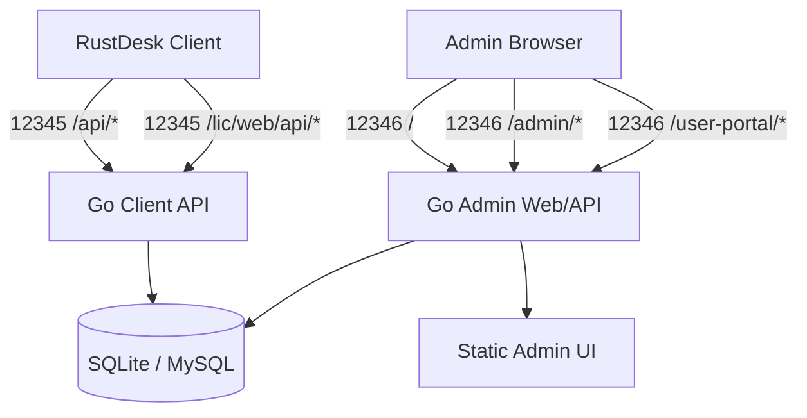

# RustDesk API Server Pro（兼容增强版）

[English](./README_EN.md)

RustDesk API Server Pro 是一个面向 RustDesk 客户端的第三方 API 服务端实现，包含 Go 后端、Vue 3 管理后台和 SQLite/MySQL 数据存储。项目目标是在保持轻量部署的前提下，补齐 RustDesk 客户端主流程所需 API，并提供更易维护的后台管理能力。

> 本项目部分内容由 ChatGPT 辅助生成，仅供参考。生产环境使用前请自行审查代码、完成真实链路测试，并按业务需求调整配置。

## 当前状态

- 当前版本：以根目录 [`VERSION`](./VERSION) 为准，当前为 `1.3.20`。
- 兼容基线：RustDesk 客户端 `1.4.9`，详见 [`docs/compat/rustdesk-current.json`](./docs/compat/rustdesk-current.json)。
- 推荐部署：单容器一体化服务，使用双 HTTP 端口隔离公网客户端 API 与内网管理后台。
- 默认客户端 API 端口：`12345/tcp`，以 `server.yaml` 的 `httpConfig.port` 为准，按需由路由器转发到公网。
- 默认管理后台 Web/API 端口：`12346/tcp`，以 `server.yaml` 的 `httpConfig.adminPort` 为准，只建议局域网或 VPN 访问。
- 默认数据库：SQLite；可切换为 MySQL。
- 管理后台：基于 Vue 3、Vite、TypeScript、Naive UI 和 UnoCSS。
- 后端框架：Go + Iris + Xorm。
- 受控 RustDesk 准入：API 侧、后台审批、策略和审计能力已实现；真正阻断客户端绕过仍需要接入改造版 `hbbs/hbbr`。

## 主要能力

- RustDesk 客户端 API 兼容层：登录选项、WebAuth 轮询、设备同步、地址簿、心跳、sysinfo、基础配置探测等。
- 管理后台：用户、设备、系统配置、访问策略、第三方登录、审计日志、错误日志、邮件模板、会话和令牌管理。
- 用户门户：普通用户可查看自己的设备、会话、通讯录和个人资料。
- 受控 RustDesk 准入 PoC：
  - 已实现 `/internal/rustdesk/auth`、`/device/register`、`/device/heartbeat`、`/relay/check` 内部接口。
  - 内部接口支持 `X-Internal-Secret` 和 `Authorization: Bearer <secret>`。
  - 设备支持待审批、已通过、已拒绝、已禁用状态。
  - 用户支持远控权限、中继权限和授权到期策略。
  - 后台支持设备审批、拒绝、禁用、启用和中继开关。
  - 日志审计中提供准入日志页面，可查看脱敏后的准入请求/响应摘要。
- 地址簿增强：账户级联系人/标签全量视图、共享地址簿、CSV 导入导出、普通用户写权限校验。
- OAuth/OIDC：统一回调 `/admin/auth/oauth/{provider}/callback`，支持后台登录和客户端登录共用链路。
- 已适配 Provider：GitHub、QQ、Google、Microsoft、Gitee、GitLab、WeChat、Apple 和通用 OIDC。
- WebAuthn/Passkey：作为后台登录的可选能力，独立于 RustDesk 客户端认证回传。
- 国际化：中文、英文及多语言翻译质量检查脚本。
- Docker 镜像：内置管理后台静态文件，无需再部署独立 `rustdesk-web` 前端容器。

> 受控准入说明：当前仓库已经完成 API 侧准入、后台管理和审计闭环；若要让“未注册或未审批设备无法连入 RustDesk 服务”真正生效，还必须使用会调用这些内部接口的改造版 `hbbs/hbbr`。官方未改造 `rustdesk-server` 不会自动调用本项目的准入接口。

## 架构概览



默认访问路径：

- RustDesk 客户端 API：`http://<host>:12345/api/...`
- plugin-sign 兼容接口：`http://<host>:12345/lic/web/api/plugin-sign`
- 管理后台页面：`http://<host>:12346/`
- 管理后台 API：`http://<host>:12346/admin/...`

生产部署时，路由器只转发客户端 API 端口 `12345`。管理端口 `12346` 不要做公网端口转发。

## 目录结构

```text
rustdesk-api-server-pro/
├── backend/                 # Go 后端
│   ├── app/                 # 控制器、中间件、表单、模型和路由
│   ├── internal/            # service、repository、core、errcode 等内部模块
│   ├── config/              # 配置读取与默认值
│   ├── db/                  # 数据库初始化与分页
│   └── server.yaml          # 本地配置示例
├── soybean-admin/           # Vue 3 管理后台
├── docker/                  # 容器启动脚本与 OpenWrt 辅助脚本
├── docs/                    # 项目文档
├── scripts/                 # 部署、兼容性和安全检查脚本
├── Dockerfile
├── docker-compose.yaml
└── VERSION                  # 版本号单一事实来源
```

## 快速开始

### Docker Compose（推荐）

```bash
mkdir -p /opt/rustdesk-api-server-pro/data
cd /opt/rustdesk-api-server-pro

curl -L -o server.yaml \
  https://raw.githubusercontent.com/liyan-lucky/rustdesk-api-server-pro/main/backend/server.yaml

cat > docker-compose.yaml <<'YAML'
services:
  rustdesk-api-server-pro:
    container_name: rustdesk-api-server-pro
    image: ghcr.io/liyan-lucky/rustdesk-api-server-pro:latest
    environment:
      - "ADMIN_USER=${ADMIN_USER:-test}"
      - "ADMIN_PASS=${ADMIN_PASS:-testadmin}"
      - "PORT=12345"
      - "ADMIN_PORT=12346"
      - "RUSTDESK_HBBS_DIR=/root"
    ports:
      - "${FNOS_HTTP_PORT:-12345}:12345" # RustDesk 客户端 API，可按需公网转发
      - "${FNOS_ADMIN_HTTP_PORT:-12346}:12346" # 管理后台 Web/API，仅内网访问
    volumes:
      - ./server.yaml:/app/server.yaml
      - ./data:/app/data
      - /vol1/docker/rustdesk/hbbs:/root:ro
    restart: unless-stopped
YAML

docker compose up -d
docker logs rustdesk-api-server-pro --tail 100
```

`ADMIN_USER` 与 `ADMIN_PASS` 仅首次初始化时用于创建管理员账号。生产环境务必覆盖默认值，并修改 `server.yaml` 中的 `signKey`。

### 本地二进制运行

```bash
cd backend
go build -o rustdesk-api-server-pro .
./rustdesk-api-server-pro sync
./rustdesk-api-server-pro start
```

若需要同时更新管理后台：

```bash
cd soybean-admin
pnpm install
pnpm build
```

构建产物需要复制到后端静态目录，确保 `server.yaml` 中 `httpConfig.staticdir` 指向正确的 `dist`。

### OpenWrt / x86 软路由

```bash
curl -L -o /tmp/update-openwrt-one-container.sh \
  https://raw.githubusercontent.com/liyan-lucky/rustdesk-api-server-pro/main/docker/update-openwrt-one-container.sh

sh /tmp/update-openwrt-one-container.sh
```

默认使用 `/mnt/docker/rustdesk-api` 作为数据目录，并按单容器一体化方式部署。详见 [`docs/OPENWRT_ONE_CONTAINER.md`](./docs/OPENWRT_ONE_CONTAINER.md)。

## 配置说明

后端配置示例位于 [`backend/server.yaml`](./backend/server.yaml)。Docker 启动脚本会将挂载的 `/app/server.yaml` 复制为运行配置，持久化目录为 `/app/data`。

关键字段：

```yaml
signKey: "CHANGE_ME_TO_A_RANDOM_32_BYTE_SECRET"
debugMode: false

db:
  driver: "sqlite"
  dsn: "./server.db"
  timeZone: "Asia/Shanghai"
  showSql: false

httpConfig:
  printRequestLog: false
  staticdir: "/app/dist"
  port: ":12345"
  adminPort: ":12346"

oauth:
  providers: []

rustdeskServer:
  idServer: ""
  relayServer: ""
  apiServer: ""
  key: ""
  internalSecret: ""
  authCacheSeconds: 60
```

配置要点：

- `signKey` 必须改为随机密钥，并在升级时保持不变。
- `httpConfig.port` 是 RustDesk 客户端 API 端口，可按需转发到公网。
- `httpConfig.adminPort` 是管理后台 Web/API 端口，应仅允许局域网或 VPN 访问。
- `httpConfig.staticdir` 在官方 Docker 镜像内应为 `/app/dist`。
- SQLite 数据库、运行配置、初始化标记和录屏上传目录建议全部持久化到 `/app/data`。
- MySQL 可通过切换 `db.driver` 与 `db.dsn` 启用。
- 反向代理环境建议正确传递 `X-Forwarded-Proto` 和 `X-Forwarded-Host`。
- `rustdeskServer.internalSecret` 用于改造版 `hbbs/hbbr` 调用内部准入接口，生产环境必须使用不少于 32 字符的随机密钥。
- `rustdeskServer.authCacheSeconds` 是 RustDesk 服务端可使用的授权缓存时间，建议 30 到 120 秒。

## 受控 RustDesk 准入 PoC

当前已完成 API 侧最小闭环：

- 设备注册后默认进入待审批状态。
- 审批通过后准入接口可返回允许。
- 禁用用户、禁用设备、关闭用户远控权限、授权过期会拒绝连接。
- 设备和用户任一侧禁止中继时，中继校验会拒绝。
- 内部准入接口会写入操作审计，准入日志页面可按设备 ID、动作、结果、错误码和时间筛选。

相关文件：

- 受控部署计划：[`docs/CONTROLLED_RUSTDESK_DEPLOYMENT_PLAN.md`](./docs/CONTROLLED_RUSTDESK_DEPLOYMENT_PLAN.md)
- PoC 接入说明：[`docs/CONTROLLED_RUSTDESK_POC.md`](./docs/CONTROLLED_RUSTDESK_POC.md)
- 基线与风险清单：[`docs/CONTROLLED_RUSTDESK_BASELINE_AND_RISKS.md`](./docs/CONTROLLED_RUSTDESK_BASELINE_AND_RISKS.md)
- 密钥轮换说明：[`docs/CONTROLLED_RUSTDESK_KEY_ROTATION.md`](./docs/CONTROLLED_RUSTDESK_KEY_ROTATION.md)
- 受控 Compose 示例：[`docker-compose.controlled.yaml`](./docker-compose.controlled.yaml)

部署前可运行预检脚本：

```bash
export RUSTDESK_API_INTERNAL_SECRET="<至少 32 字符随机密钥>"
export RUSTDESK_CONTROLLED_SERVER_IMAGE="<改造版 rustdesk-server 镜像>"
scripts/deploy/controlled-preflight.sh .
```

注意：受控 Compose 示例要求 `RUSTDESK_CONTROLLED_SERVER_IMAGE` 是改造版 `rustdesk-server` 镜像。若使用官方未改造镜像，只能启动服务，不能证明注册制在协议层生效。

## 登录与 OAuth

### RustDesk 客户端 WebAuth

客户端按官方轮询协议完成认证：

1. 客户端请求 `/api/login-options` 获取 WebAuth 入口。
2. 浏览器打开登录页并携带一次性 poll token。
3. 用户完成密码或 OAuth 登录后，服务端写入一次性认证结果。
4. 客户端通过轮询接口直接取得认证 JSON。
5. 浏览器成功页只提供关闭页面和返回 RustDesk 的兜底操作，不承担 token 回传职责。

### 第三方登录

新版统一使用 `oauth.providers`。管理后台登录回调地址为：

```text
/admin/auth/oauth/<provider>/callback
```

客户端第三方登录回调地址为：

```text
/api/oauth/<provider>/callback
```

后台登录使用一次性 ticket 换取前端会话；客户端 OAuth 通过 state 中的 poll token 写入客户端轮询结果。回调失败统一使用 `ERR-22xx` 错误码。

Provider 示例：

```yaml
oauth:
  providers:
    - type: "github"
      name: "github"
      displayName: "GitHub"
      enabled: true
      clientId: "YOUR_GITHUB_CLIENT_ID"
      clientSecret: "YOUR_GITHUB_CLIENT_SECRET"
      redirectUrl: "https://desk.example.com/admin/auth/oauth/github/callback"
      scopes: ["read:user", "user:email"]
      accountRole: "admin"
      bindByEmail: true
      autoCreateAdmin: false
```

更完整的 Provider 规则、账户绑定边界和客户端回调说明见 [`docs/OAUTH_PROVIDERS.md`](./docs/OAUTH_PROVIDERS.md)。

## 开发与验证

后端：

```bash
cd backend
go test ./...
go vet ./...
go build -o rustdesk-api-server-pro .
```

前端：

```bash
cd soybean-admin
pnpm i18n:sanitize:guard
pnpm i18n:check
pnpm typecheck
pnpm build
```

兼容性冒烟：

```bash
bash scripts/compat/smoke-api.sh http://127.0.0.1:12345
TOKEN=YOUR_TOKEN bash scripts/compat/smoke-api.sh http://127.0.0.1:12345
```

提交前请至少执行受影响模块的测试。所有对外业务错误应包含 `ERR-xxxx` 前缀；鉴权中间件返回 401/406 时应使用 `StopWithJSON`。

## 升级与持久化

建议持久化：

- `/app/data/server.db`
- `/app/data/server.yaml`
- `/app/data/.init.lock`
- `/app/data/record_uploads/`

升级后建议执行或确认容器启动脚本已执行：

```bash
rustdesk-api-server-pro sync
```

从旧部署升级时，建议停用或删除旧 `rustdesk-web` / nginx 前端容器，只保留当前一体化容器，避免访问到旧前端导致登录或路由异常。

## 常见问题

### 管理后台首页打不开，但 `/api/*` 正常

先确认访问的是管理端口 `12346`，再检查 `httpConfig.staticdir` 是否指向正确的前端构建产物。Docker 镜像内应指向 `/app/dist`。

### 升级后页面报字段不存在

通常是数据库结构未同步。执行 `sync` 后重启服务。

### 第三方登录按钮不显示

检查是否仍访问旧前端容器，并确认至少有一个 `oauth.providers` Provider 已启用。

### OAuth 回调提示 state 过期或无效

检查外部访问入口、反向代理头、Provider 回调白名单和 `redirectUrl` 是否完全一致。

### 客户端提示 404

开启 `httpConfig.printRequestLog` 临时观察请求路径，并对照 [`docs/API_MATRIX.md`](./docs/API_MATRIX.md) 和 [`docs/compat/rustdesk-current.json`](./docs/compat/rustdesk-current.json)。

## 截图


## 文档索引

- [`docs/README.md`](./docs/README.md)：完整文档索引
- [`docs/CURRENT_STATUS.md`](./docs/CURRENT_STATUS.md)：当前仓库状态
- [`docs/PROJECT_DESCRIPTION.md`](./docs/PROJECT_DESCRIPTION.md)：项目详细描述
- [`docs/PROJECT_WORKFLOW.md`](./docs/PROJECT_WORKFLOW.md)：开发、验证和发布流程
- [`docs/USAGE.md`](./docs/USAGE.md)：使用说明
- [`docs/DOCKER.md`](./docs/DOCKER.md)：Docker 部署说明
- [`docs/OPENWRT_ONE_CONTAINER.md`](./docs/OPENWRT_ONE_CONTAINER.md)：OpenWrt 一体化部署
- [`docs/OAUTH_PROVIDERS.md`](./docs/OAUTH_PROVIDERS.md)：OAuth Provider 规范
- [`docs/TROUBLESHOOTING.md`](./docs/TROUBLESHOOTING.md)：排障手册
- [`docs/SECRET_HANDLING.md`](./docs/SECRET_HANDLING.md)：密钥处理规范
- [`docs/CHANGELOG.md`](./docs/CHANGELOG.md)：变更日志

## 许可证

本项目使用 AGPL-3.0 许可证，详见 [`LICENSE`](./LICENSE)。
